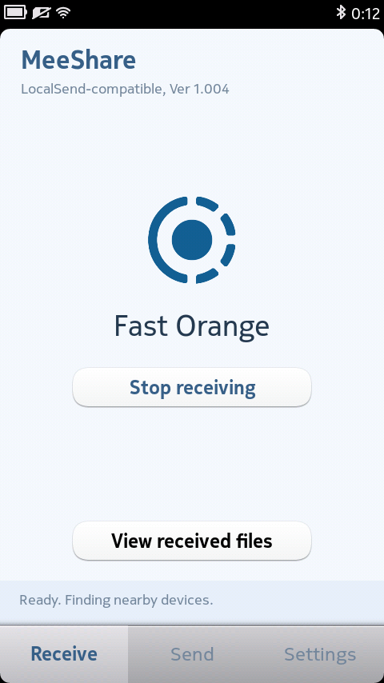
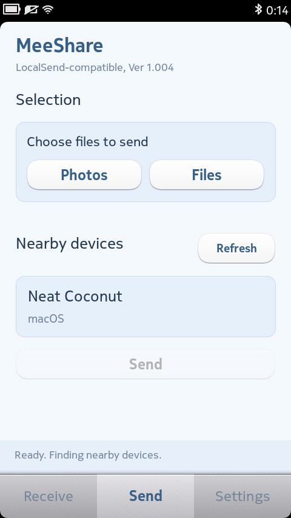
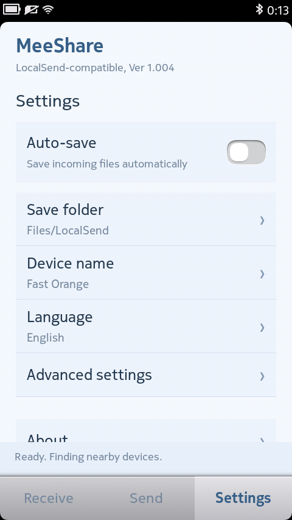

# MeeShare — LocalSend-compatible file transfer for MeeGo

English | [简体中文](README.zh-CN.md)

A local-network file transfer app for Nokia N9, built with Qt 4.7 and native MeeGo components. Using the LocalSend protocol, MeeShare exchanges files with compatible devices on the same WiFi network.

This is an independently developed LocalSend-compatible client.

## Screenshots

Screenshots captured on Nokia N9 with the English interface.

| Receive | Send | Settings |
| --- | --- | --- |
|  |  |  |

## Features

- Discover nearby devices on the local network and display their names
- Send and receive files, with multiple selection for photos and files
- Accept or reject incoming requests, or enable automatic saving in Settings
- Choose a receive folder; the default is the LocalSend folder in the phone's file storage
- Set a device name or generate a random one
- Simplified Chinese, Traditional Chinese, English, Japanese and Korean interfaces
- File transfers over HTTPS / TLS 1.2

## Installation and use

Supported device: Nokia N9 running MeeGo 1.2 Harmattan PR1.3. Other devices and firmware versions have not been verified.

1. Download the `.deb` package from this repository's Releases page and copy it to the phone
2. Open it with the phone's system installer and follow the prompts
3. Connect the phone and the other device to the same WiFi network, then open the app on both
4. On Send, select photos or files, connect to the target device and tap Send; accept the request on the other device
5. On Receive, enable or stop receiving and browse received files

Keep the app open during transfers.

## Current limitations

- Incoming files are limited to 64 MiB each, with at most 20 files and 128 MiB per receive request
- Recursive folder transfers, resume, PIN verification and browser sharing links are not supported
- Files with the same name must be sent in separate batches; existing files are not overwritten on receipt
- Receiving does not continue after the app is closed; no persistent background service is provided
- Intended for private IPv4 local networks; guest networks, client isolation or multicast restrictions may prevent discovery or connection

## Credits

- MeeGo client development, adaptation and interface design: Chih
- LocalSend protocol and random-name dictionaries: the LocalSend project and contributors
- Network encryption: the Mbed TLS project and contributors
- JSON processing: the QJson project and contributors
- Native interface and runtime: Qt, MeeGo Harmattan and their contributors

Thanks to LocalSend for publishing the protocol and related resources, making file transfers between older and modern devices possible.

## License

Original client code, the MeeShare logo and app icon are licensed under [Apache 2.0](LICENSE), copyright 2026 Chih. Third-party resources and components retain their own copyright notices and licenses; see [third-party notices](docs/THIRD_PARTY.md).

The LocalSend name is used only to describe protocol compatibility and resource provenance. MeeShare is not an official LocalSend product.

## Building

See the [build instructions](docs/BUILD.md). The repository does not include the Nokia SDK or system firmware.
