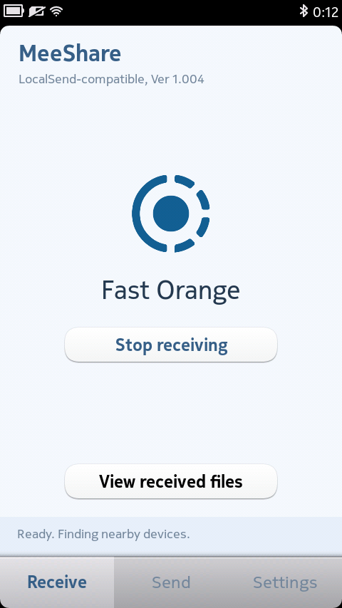
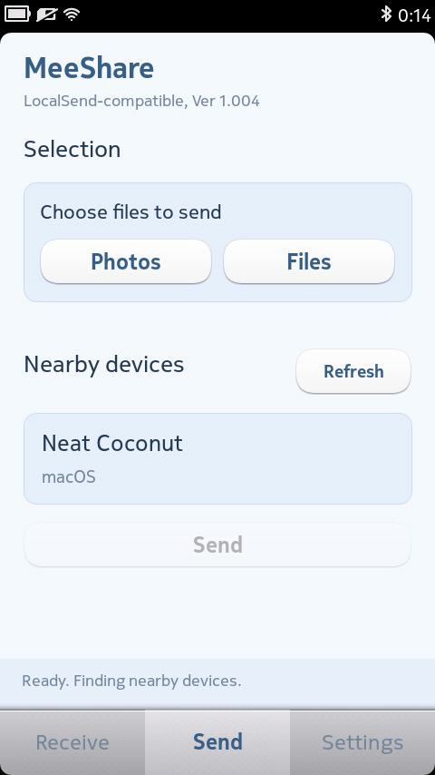
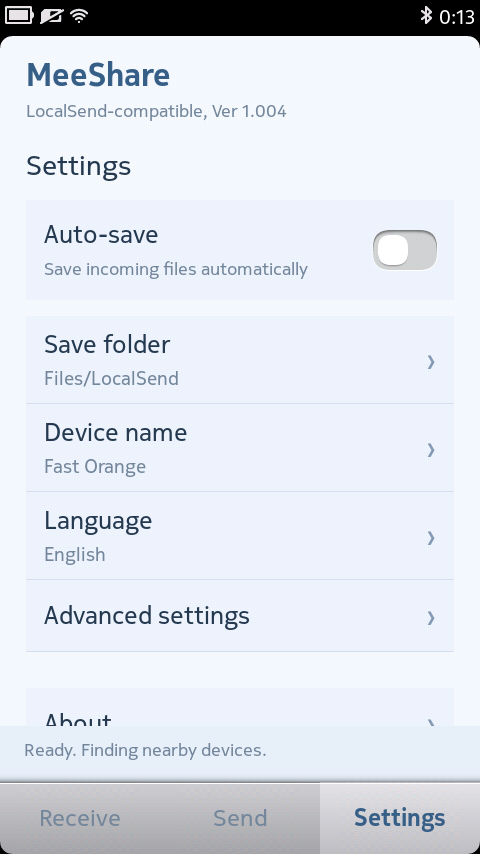

# MeeShare - MeeGo 端 LocalSend 局域网文件传输应用

[English](README.md) | 简体中文

为 Nokia N9 开发的 MeeGo 局域网文件传输应用，使用 Qt 4.7 与 MeeGo 原生控件，通过 LocalSend 协议，可以与同一 WiFi 网络中的兼容设备互相发送文件

这是独立开发的 LocalSend 兼容客户端

### 界面截图

Nokia N9 真机截图，展示英文界面。

| 接收 | 发送 | 设置 |
| --- | --- | --- |
|  |  |  |

### 功能

- 在局域网中发现设备，显示对方的设备名称
- 发送和接收文件，支持照片与文件多选
- 收到请求时选择接受或拒绝，也可在设置中开启自动保存
- 自选接收目录，默认保存至手机文件区域的 LocalSend 文件夹
- 自定义设备名称，也可使用随机名称
- 支持简体中文、繁体中文、英文、日文与韩文
- 使用 HTTPS / TLS 1.2 传输文件

### 安装与使用

适用设备为运行 MeeGo 1.2 Harmattan PR1.3 的 Nokia N9，其他设备或固件版本尚未验证。

1. 在本仓库的 Releases 页面下载安装包，将 `.deb` 文件传入手机
2. 使用手机系统安装器打开，按照提示完成安装
3. 让手机与目标设备连接到同一个 WiFi 网络，并打开两端的应用
4. 在“发送”页选择照片或文件、连接目标设备，然后点击发送；在另一端确认接收
5. 在“接收”页可以开启或停止接收，也可以查看已接收的文件

请在传输期间保持应用打开。

### 当前限制

- 单个接收文件上限为 64 MiB，单次接收请求最多 20 个文件、合计 128 MiB。
- 目前不支持文件夹递归传输、断点续传、PIN 验证及网页分享链接
- 同名文件需要分批发送；接收时不覆盖已有文件
- 暂不支持后台常驻或退出应用后继续接收
- 当前以私有 IPv4 局域网为使用范围；访客网络、设备隔离或多播限制可能影响发现和连接

### Credits

- MeeGo 客户端开发、适配与界面设计：Chih
- LocalSend 协议与随机名称词库：LocalSend 项目及贡献者
- 网络加密：Mbed TLS 项目及贡献者
- JSON 处理：QJson 项目及贡献者
- 原生界面与运行环境：Qt、MeeGo Harmattan 及相关贡献者

感谢 LocalSend 公开协议和相关资源，让旧设备也能参与现代设备之间的文件传输。

### 许可证

原创客户端代码、MeeShare logo 和 icon 采用 [Apache 2.0](LICENSE) 许可证，Copyright 2026 Chih。LocalSend 相关资源、Mbed TLS、QJson 等第三方内容保留其原有版权及许可证，详细说明见[第三方声明](docs/THIRD_PARTY.zh-CN.md)。

LocalSend 名称仅用于说明协议兼容性及资源来源，不表示本应用属于官方项目。

### 构建

请参阅[构建说明](docs/BUILD.zh-CN.md)。仓库不附带 Nokia SDK 或系统固件。

